# Manual de usuario — GoldStone Hub

**Versión:** v0.1.0  
**Fecha:** 16 de agosto de 2026  
**Fuente de evidencia:** [README.md](../README.md), [package.json](../package.json), rutas en `src/app/(student)` y `src/app/(admin)`, menús en `src/app/(student)/layout.tsx` y `src/app/(admin)/layout.tsx`, autenticación en `src/lib/auth.ts`, simulador en `src/lib/simulator.ts`, seed en `prisma/seed.ts`.

---

## 1. Resumen del sistema

**GoldStone Hub** es una plataforma web de formación profesional. Reúne en un solo lugar:

- Una **ruta de aprendizaje** con cursos, módulos y lecciones.
- **Actividades** vinculadas a cada lección.
- Una **biblioteca** de materiales (archivos y enlaces).
- Un **simulador formativo** para prepararse al estándar de competencia **EC0110.02** (no emite la certificación oficial).

El problema que resuelve: el alumno sabe qué estudiar, qué tiene pendiente y qué temas reforzar, sin repartir el contenido entre varias herramientas.

---

## 2. Requisitos para usarlo

| Requisito | Detalle (según repo) |
|---|---|
| Navegador | Moderno (Chrome, Edge, Firefox, Safari reciente) |
| Dispositivo | Computadora o celular (interfaz adaptable) |
| URL local documentada | [http://localhost:3040](http://localhost:3040) — ver [README.md](../README.md) |
| Credenciales | Solo correos **invitados** por un administrador (acceso por enlace, sin contraseña) |
| Conexión | Internet para abrir enlaces externos (YouTube, etc.) |

---

## 3. Acceso e inicio de sesión

GoldStone Hub usa **enlace de un solo uso** enviado al correo (magic link). No hay contraseña.

### Pantalla de acceso

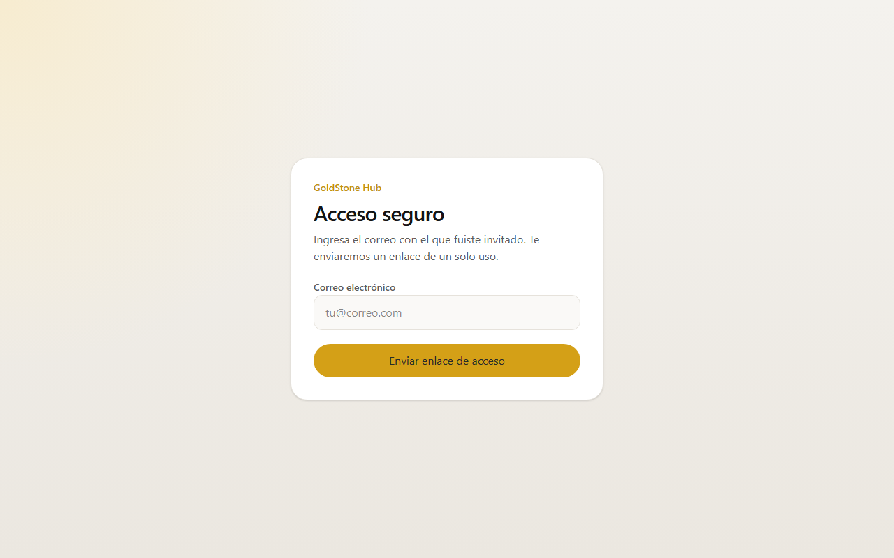

1. Abre la URL de la plataforma (en este entorno: `http://localhost:3040/login`).
2. Escribe el correo con el que te invitaron.
3. Pulsa **Enviar enlace de acceso**.

### Confirmación de envío

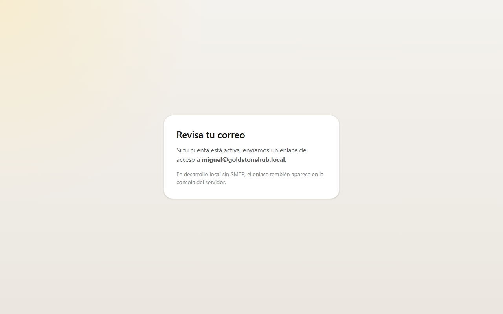

4. Verás el mensaje **Revisa tu correo**.
5. Abre el enlace del mensaje (en instalaciones locales sin SMTP, el enlace también puede verse en la consola del servidor o en el archivo de desarrollo `uploads/last-magic-link.txt`).
6. Quedarás dentro de la plataforma según tu rol:
   - Alumno → `/inicio`
   - Administrador / Instructor → `/admin`

### Mensajes frecuentes en el acceso

| Mensaje | Qué significa | Qué hacer |
|---|---|---|
| «No encontramos una invitación activa para este correo.» | El correo no está registrado o la cuenta está inactiva (`src/app/login/login-form.tsx`) | Pedir al administrador que te invite o reactive |
| «Tu correo no tiene invitación activa.» | Acceso denegado (`AccessDenied`) | Verificar correo exacto y estado activo |
| «No se pudo enviar el enlace…» | Fallo de envío | Reintentar; en local revisar consola del servidor |

---

## 4. Roles y permisos

Definidos en `prisma/schema.prisma` (`UserRole`) y aplicados en `src/proxy.ts` / `src/lib/auth.ts` / `src/lib/assignments.ts`.

| Rol | Quién es | Qué puede hacer | Qué no puede hacer |
|---|---|---|---|
| **Estudiante (`STUDENT`)** | Alumno inscrito | Ver contenido publicado, completar lecciones/actividades, usar biblioteca y simulador, ver su perfil | Entrar a `/admin` ni ver borradores |
| **Administrador (`ADMIN`)** | Operador de la escuela | Gestionar cursos, alumnos, biblioteca, simulador y resultados; **publicar** contenido | — |
| **Instructor (`INSTRUCTOR`)** | Experto externo asignado | Editar el contenido que tenga asignado (en borrador) | Publicar; administrar la escuela completa; ver alumnos/resultados globales |

---

## 5. Guía rápida

### Objetivo A — Continuar estudiando (alumno)

1. Inicia sesión con tu correo invitado.
2. En **Inicio**, revisa el héroe de tu ruta y pulsa **Continuar aprendiendo**.
3. Lee la lección y completa las actividades obligatorias.
4. Marca la lección como completada cuando el sistema lo permita.
5. Vuelve a **Inicio** para ver el avance actualizado.

### Objetivo B — Practicar el simulador (alumno)

1. Entra a **Simulador**.
2. Lee el aviso: es preparación formativa, no evaluación oficial.
3. Elige **Simulacro completo**, **Repaso de errores** o práctica por elemento.
4. Contesta y envía el intento.
5. Revisa calificación, fallos y temas a reforzar.

### Objetivo C — Publicar una lección (administrador)

1. Entra a **Cursos** → abre el curso.
2. Crea o edita módulo / lección / actividad.
3. Usa **Publicar** en cada nivel necesario (y en el curso).
4. Verifica como alumno que el borrador ya no aparece y el publicado sí.

---

## 6. Funcionalidades por módulo (alumno)

Menú según `src/app/(student)/layout.tsx`.

### 6.1 Inicio

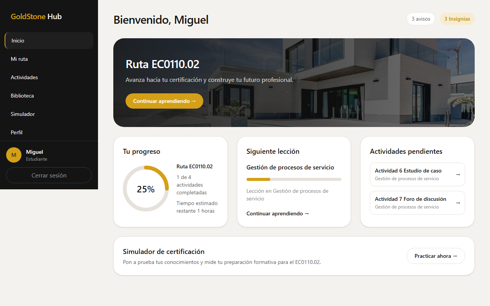

- Saludo personalizado.
- Banner de la ruta asignada (ej. **Ruta EC0110.02**).
- **Tu progreso** (porcentaje y actividades).
- **Siguiente lección** recomendada.
- **Actividades pendientes**.
- Acceso rápido al **Simulador de certificación**.

> Nota: los indicadores «3 avisos» y «3 Insignias» del diseño son placeholders visuales en esta versión; no hay módulo de notificaciones/insignias reales aún.

### 6.2 Mi ruta

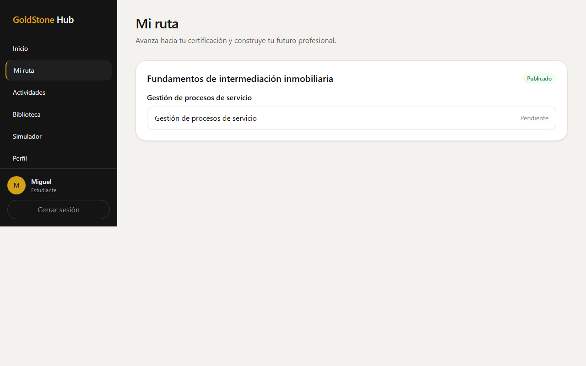

- Lista de cursos → módulos → lecciones publicadas.
- Estado por lección (pendiente / completada).
- Entrada a la ficha de cada lección.

### 6.3 Detalle de lección

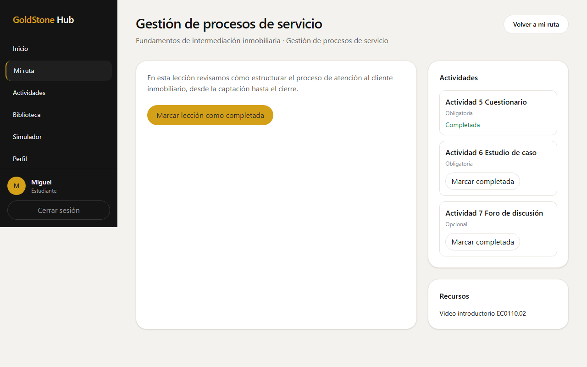

- Contenido de estudio.
- Lista de actividades (obligatorias u opcionales) con **Marcar completada**.
- Recursos adjuntos (descarga autenticada o enlace externo).
- Botón **Marcar lección como completada** (exige actividades obligatorias hechas).

### 6.4 Actividades

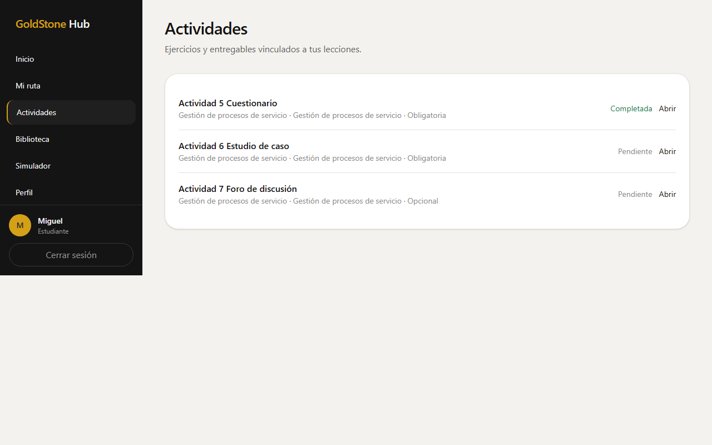

- Vista consolidada de actividades de la ruta.
- Indica si es obligatoria/opcional y si está pendiente o completada.
- Enlace **Abrir** hacia la lección relacionada.

### 6.5 Biblioteca

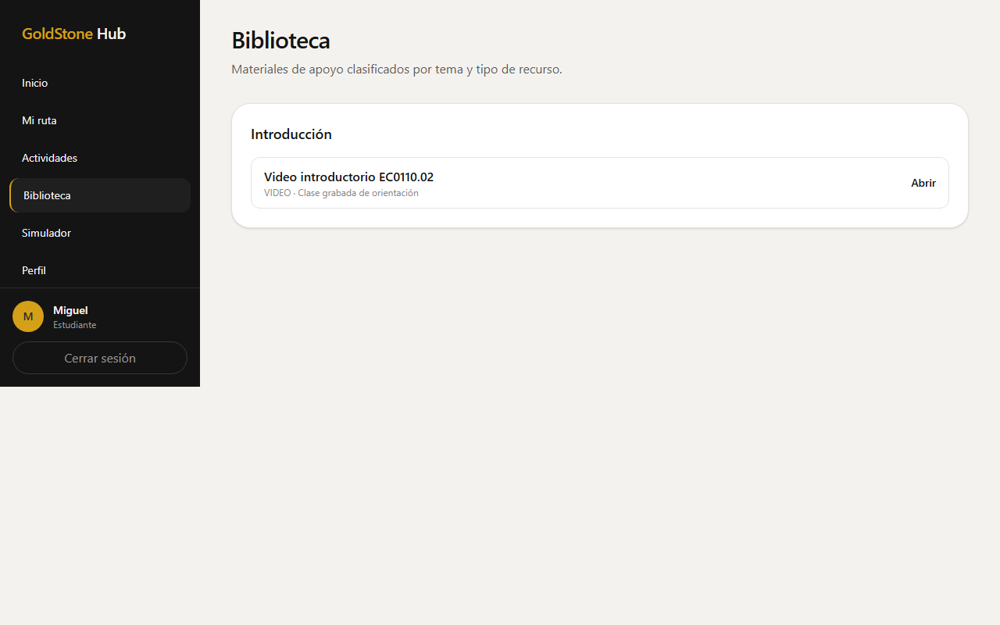

- Materiales publicados y visibles en biblioteca, agrupados por tema.
- Tipos previstos: PDF, PPT, DOC, XLS, LINK, PODCAST, VIDEO, BOOK.
- **Abrir** (URL) o **Descargar** (archivo; requiere sesión).

### 6.6 Simulador

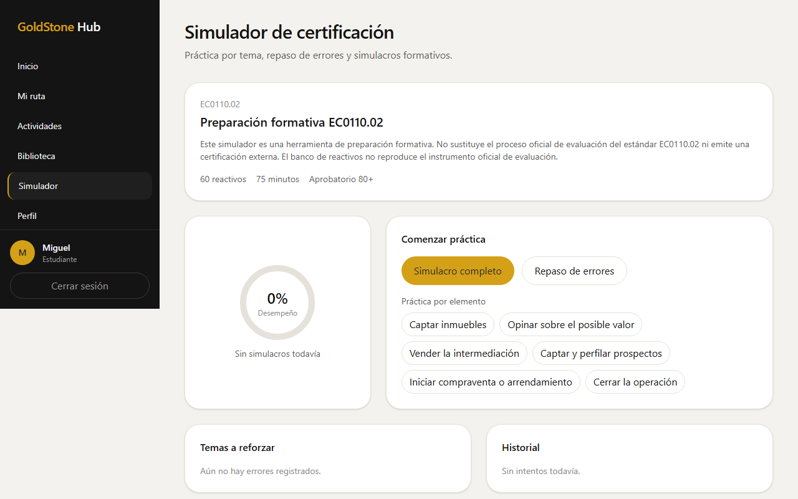

Reglas documentadas en producto / `src/lib/simulator.ts` y seed:

- Certificación formativa **EC0110.02**.
- Simulacro completo: **60** reactivos, **75** minutos, aprueba con **80** o más.
- Modos: simulacro completo, práctica por elemento, repaso de errores.
- Historial de intentos y temas a reforzar.
- Disclaimer: no sustituye la evaluación oficial ni reproduce el instrumento oficial.

### 6.7 Perfil

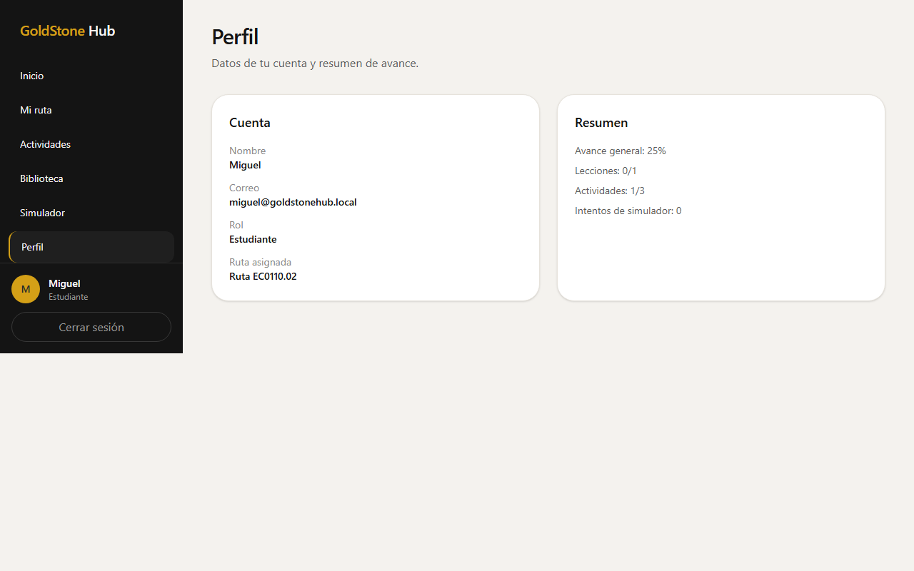

- Nombre, correo, rol.
- Ruta asignada.
- Resumen de avance (lecciones, actividades, intentos de simulador).

---

## 7. Funcionalidades por módulo (administración)

Menú según `src/app/(admin)/layout.tsx`. Rutas bajo `/admin`.

### 7.1 Resumen

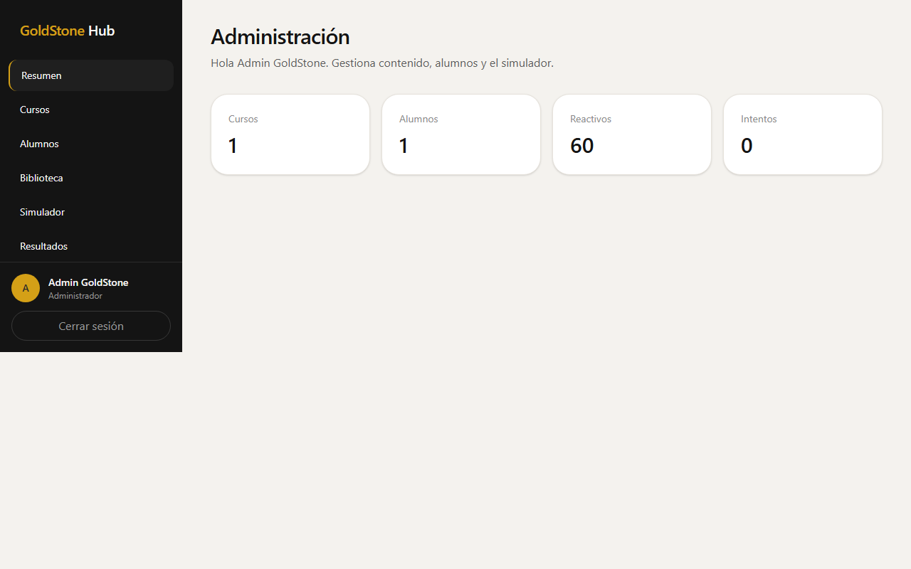

Tarjetas de conteo: cursos, alumnos, reactivos e intentos, con enlaces a cada módulo.

### 7.2 Cursos

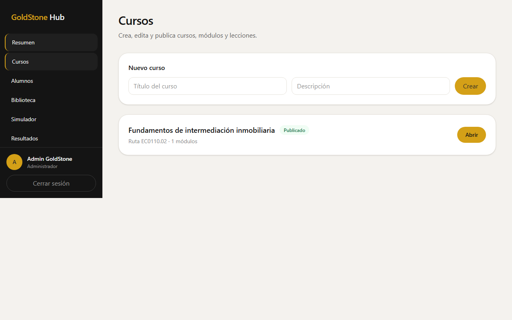

- Listado de cursos (el instructor solo ve los asignados).
- Alta de curso (solo admin).
- Entrada al editor del curso.

#### Detalle / editor de curso

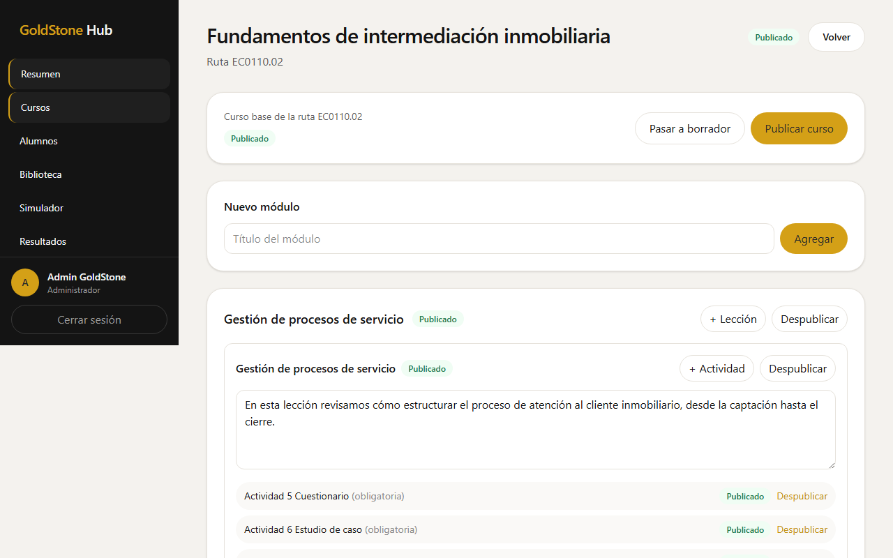

- Publicar / pasar a borrador el curso (solo admin).
- Agregar módulos, lecciones y actividades.
- Editar contenido de lección.
- Publicar o despublicar módulos, lecciones y actividades (solo admin).
- El instructor puede editar en borrador; la UI indica que no publica.

### 7.3 Alumnos e instructores

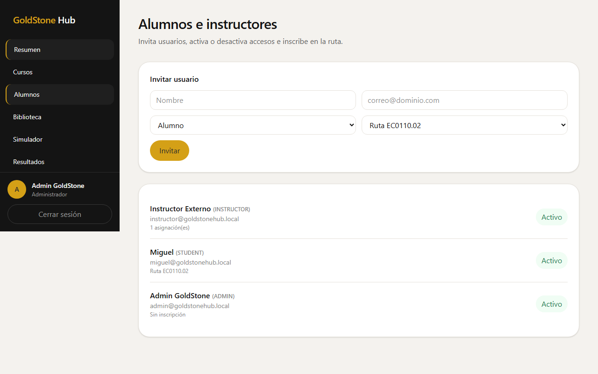

- Invitar usuarios (nombre, correo, rol).
- Inscribir alumnos a la ruta.
- Asignar curso a instructores.
- Activar / desactivar acceso (botón Activo / Inactivo).

Solo rol **ADMIN** (un instructor que entre a esta URL es redirigido).

### 7.4 Biblioteca (admin)

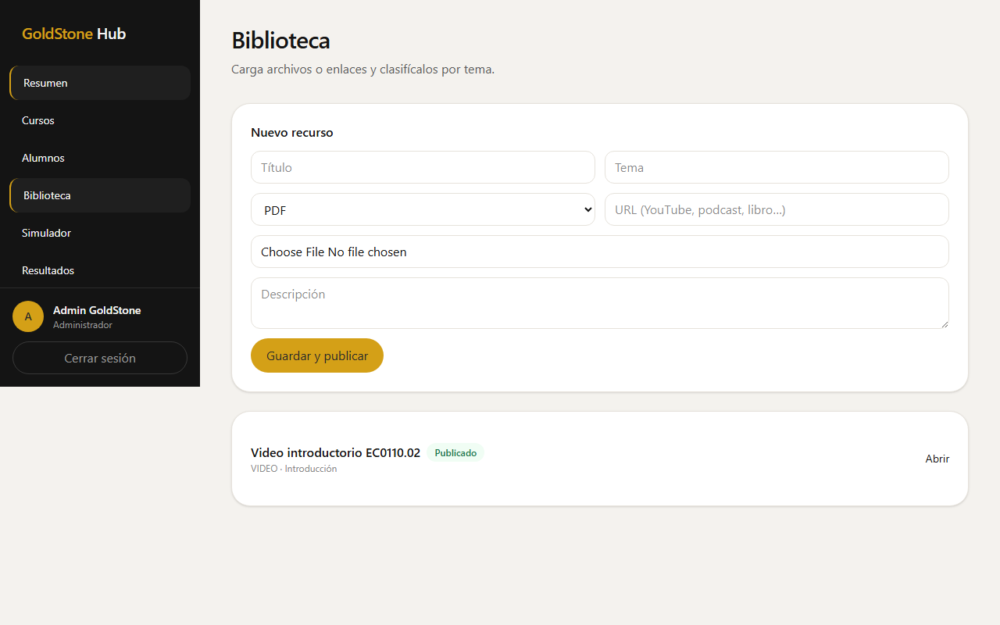

- Alta de recursos: título, tema, tipo, URL y/o archivo.
- El admin guarda y publica; el instructor guarda borrador.
- Descarga autenticada de archivos subidos.

### 7.5 Simulador (admin)

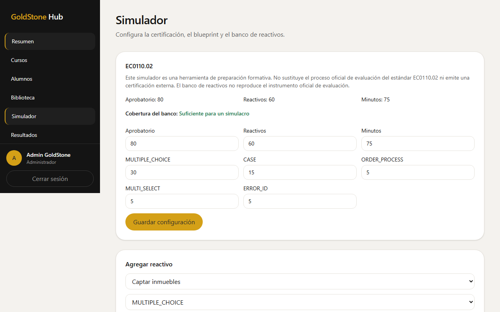

- Ver configuración (aprobatorio, cantidad, minutos, blueprint por tipo).
- Indicador de **cobertura del banco** (suficiente / insuficiente para un simulacro).
- Agregar reactivos al banco.
- Listado de reactivos recientes.

### 7.6 Resultados

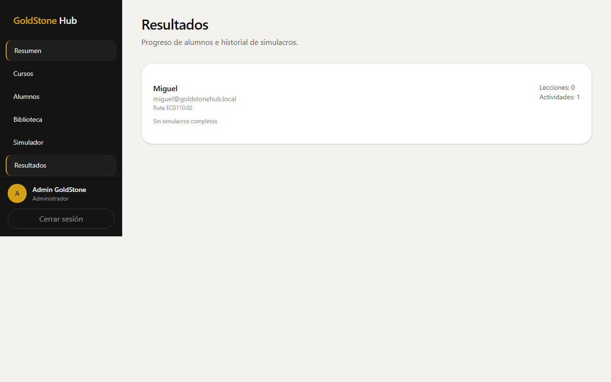

- Progreso por alumno (lecciones y actividades completadas).
- Últimos simulacros completos con porcentaje y aprobado / no aprobado.

---

## 8. Flujos clave

### 8.1 Completar una lección (alumno)

```text
Inicio / Mi ruta → Lección → Marcar actividades → Marcar lección completada
```

Si faltan actividades obligatorias, la API responde error y la UI muestra el mensaje (`src/lib/progress.ts`, `src/app/(student)/mi-ruta/lecciones/[id]/actions.tsx`).

### 8.2 Cerrar un módulo

Cuando todas las lecciones publicadas del módulo están completadas y sus actividades **required** también, el sistema registra el cierre del módulo (`maybeCompleteModule` en `src/lib/progress.ts`).

### 8.3 Simulacro completo

```text
Simulador → Simulacro completo → Contestar → Enviar intento → Ver resultado / refuerzo
```

Si el banco no cubre el blueprint, el inicio falla con mensaje de banco insuficiente.

### 8.4 Invitar a un alumno (admin)

```text
Admin → Alumnos → Invitar usuario (rol Alumno + ruta) → El alumno pide magic link con ese correo
```

### 8.5 Publicar contenido (admin)

```text
Admin → Cursos → Abrir curso → Crear/editar → Publicar actividad/lección/módulo/curso
```

Los alumnos solo ven elementos con estado `PUBLISHED` en toda la cadena (ruta, curso, módulo, lección).

---

## 9. Mensajes de error y cómo resolverlos

| Situación | Origen probable | Resolución |
|---|---|---|
| No entra con tu correo | No invitado o `active = false` | Admin invita/reactiva en **Alumnos** |
| «Completa las actividades obligatorias…» | Intento de cerrar lección prematuro | Completar actividades marcadas como obligatorias |
| «Banco insuficiente…» | Faltan reactivos por tipo | Admin carga más preguntas en **Simulador** |
| «Aún no tienes respuestas incorrectas…» | Repaso sin historial de fallos | Hacer primero un simulacro o práctica |
| «Solo un administrador puede publicar» | Instructor intenta publicar | Pedir publicación al admin |
| «Sin permiso» en cursos | Instructor sin asignación | Admin asigna el curso al instructor |
| Descarga de archivo falla / 403 | Sesión inválida o recurso no publicado | Volver a iniciar sesión; verificar publicación |
| Página de admin redirige a inicio | Usuario alumno | Usar menú de estudiante |
| Página de alumno redirige a admin | Usuario staff | Usar panel `/admin` |

---

## 10. FAQ

**¿GoldStone Hub me entrega la certificación EC0110.02?**  
No. El simulador es **preparación formativa**. No sustituye el proceso oficial de evaluación.

**¿Necesito contraseña?**  
No. El acceso es por enlace de un solo uso al correo invitado.

**¿Puedo ver cursos en borrador?**  
No, si eres alumno. Solo el contenido publicado.

**¿Qué pasa si se me pasa el tiempo del simulacro?**  
Al enviar, el intento puede quedar como expirado; se califica lo contestado.

**¿Un instructor ve todos los alumnos?**  
No. En esta versión el panel de alumnos/resultados es de administrador. El instructor trabaja el contenido asignado.

**¿Puedo previsualizar Word/PowerPoint/Excel dentro de la plataforma?**  
En el MVP, los archivos se **descargan**; los enlaces (p. ej. YouTube) se abren fuera.

**¿Hay pagos o suscripciones?**  
No están en el alcance de esta versión ([README.md](../README.md) / alcance de producto).

---

## 11. Glosario

| Término | Significado en GoldStone Hub |
|---|---|
| **Ruta** | Trayecto de aprendizaje principal (en el MVP suele haber una: EC0110.02) |
| **Curso / Módulo / Lección** | Niveles de organización del contenido |
| **Actividad** | Tarea asociada a una lección; puede ser obligatoria u opcional |
| **Biblioteca** | Catálogo de materiales de apoyo |
| **Reactivo** | Pregunta del banco del simulador |
| **Blueprint** | Distribución de cantidad de reactivos por tipo en un simulacro |
| **Simulacro completo** | Intento de 60 reactivos con tiempo y umbral de aprobación |
| **Borrador / Publicado** | Estados de visibilidad del contenido |
| **Magic link** | Enlace de acceso de un solo uso enviado por correo |
| **EC0110.02** | Estándar de competencia objetivo de la preparación formativa |

---

## 12. Soporte y cómo reportar un problema

En el repositorio **no hay** un correo o canal de soporte al usuario final documentado.

Para reportar un problema al equipo técnico, incluye:

1. URL exacta y rol (alumno / admin / instructor).
2. Correo usado (sin compartir el enlace mágico completo).
3. Pasos para reproducir.
4. Captura de pantalla y mensaje de error mostrado.
5. Fecha/hora aproximada.

En entorno local de desarrollo, el administrador del servidor puede revisar la consola de `npm run dev` / `npm start` y la base de datos.

---

## 13. Por confirmar / Pendientes

| Tema | Qué falta | Dónde se buscó |
|---|---|---|
| URL de producción / staging | Solo está documentada la URL local `http://localhost:3040` | [README.md](../README.md), [.env.example](../.env.example) |
| Canal oficial de soporte | No hay email/teléfono/Helpdesk en el repo | README, UI de perfil, admin |
| Texto legal definitivo CONOCER/SEP | Hay disclaimer genérico; falta wording oficial aprobado | Seed / pantalla simulador |
| Preguntas del diagnóstico inicial | Fuera del MVP actual; no hay pantallas de diagnóstico | Rutas `src/app`, schema Prisma |
| Avisos e insignias reales | UI muestra placeholders «3 avisos / 3 Insignias» | `src/app/(student)/inicio/page.tsx` |
| Credenciales de un entorno compartido no local | Solo usuarios seed de desarrollo | [README.md](../README.md), `prisma/seed.ts` |

### Usuarios seed (solo entorno local de desarrollo)

| Correo | Rol |
|---|---|
| `miguel@goldstonehub.local` | Estudiante |
| `admin@goldstonehub.local` | Administrador |
| `instructor@goldstonehub.local` | Instructor |

---

## Anexo A — Mapa del repositorio (resumen)

Aplicación **web** (Next.js App Router), un solo deploy:

```text
GS_HUB/
├── README.md                 → Arranque y usuarios seed
├── DocProyecto/
│   ├── ManualUsuario.md      → Este manual
│   └── imagenesManual/       → Capturas reales
├── prisma/                   → Modelo de datos y seed
├── scripts/                  → Utilidades (admin, capturas del manual)
├── src/app/
│   ├── login/                → Acceso magic link
│   ├── (student)/            → Inicio, ruta, actividades, biblioteca, simulador, perfil
│   ├── (admin)/admin/        → Panel de administración
│   └── api/                  → Auth, progreso, simulador, admin
└── src/lib/                  → Auth, progreso, simulador, storage, RBAC
```

### Capturas incluidas en este manual

Tomadas el 16/08/2026 contra la app real en `http://localhost:3040` (script `scripts/capture-manual-screenshots.mjs`):

`01_login`, `01b_login_enlace_enviado`, `02_dashboard_alumno`, `03_mi_ruta`, `04_leccion_detalle`, `05_actividades`, `06_biblioteca_alumno`, `07_simulador`, `08_perfil`, `09_admin_resumen`, `10_admin_cursos`, `11_admin_curso_detalle`, `12_admin_alumnos`, `13_admin_biblioteca`, `14_admin_simulador`, `15_admin_resultados`.
